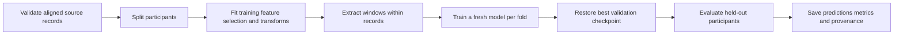

# Unimodal 3D Kinetics Estimation from Insole or IMU

Actively maintained research code for estimating per-foot plantar kinetics from **processed inertial kinematics** or **distributed plantar vGRF from smart insoles**. The two sensing routes share a training and evaluation workflow, while retaining their own inputs, configurations and article attribution.

[Articles and citations](docs/PAPERS.md) | [Data preparation](docs/DATA_CONTRACT.md) | [Configuration guide](configs/README.md) | [Model guide](models/README.md)

## Articles and notebooks

| Study | Article | Start with |
| --- | --- | --- |
| **Km2Kn** | *Deep learning-based reconstruction of a complete 3D plantar kinetic profile from optimized inertial kinematics*. **Manuscript under journal revision**, as of October 2026; a final citation/DOI will be added when available. | [Km2Kn.ipynb](Km2Kn.ipynb) - processed kinematic trajectories to forces, moments or CoP. |
| **Insole2Kn3D** | Sakib Mahmud, Muhammad E. H. Chowdhury, and Faycal Bensaali. *3D Foot Kinetics Estimation From Distributed VGRF From Smart Insoles via 1D Domain Transformation*. **IEEE Journal of Biomedical and Health Informatics**, 30(3), 2656-2667, March 2026. [DOI: 10.1109/JBHI.2025.3605296](https://doi.org/10.1109/JBHI.2025.3605296). | [Insole2Kn_3DGRFMCoP.ipynb](Insole2Kn_3DGRFMCoP.ipynb) - one workflow for forces, moments and center of pressure; select the target and foot in Section 2. |

The published article first appeared online on September 5, 2025. Its original repository address, [Insole-to-3DGRFMCoP](https://github.com/Sakib1263/Insole-to-3DGRFMCoP), resolves to this repository. Both articles are described in the [paper correspondence and citation guide](docs/PAPERS.md).

Km2Kn consumes processed Xsens joint and segment trajectories. Its default configuration selects six bilateral ankle-region channels. Insole2Kn3D consumes the selected foot's 16 pressure channels. Each experiment predicts **one target for one foot** against the instrumented treadmill reference; repeat with separate configurations for other targets and feet.

| Target | Meaning in the source coordinate convention |
| --- | --- |
| `Fx`, `Fy`, `Fz` | Anteroposterior, vertical and mediolateral ground reaction forces. |
| `Mx`, `My`, `Mz` | Ground reaction moments about the corresponding axes. |
| `CoPx`, `CoPz` | Anteroposterior and mediolateral center of pressure. |

`LL` and `RL` denote left and right foot. Confirm coordinate conventions and units against the actual source files.

## 1. Install

Use **Python 3.12** in an isolated environment. From the repository folder:

```bash
python -m venv .venv
```

Activate it using your shell:

```powershell
# Windows PowerShell
.\.venv\Scripts\Activate.ps1
```

```bash
# Linux / WSL
source .venv/bin/activate
```

Install the runtime and notebook interface:

```bash
python -m pip install -r requirements-notebooks.txt
```

For command-line execution only, use `python -m pip install -r requirements.txt`. The runtime uses TensorFlow 2.20 and Keras 3. CPU execution is supported; a compatible Linux/WSL CUDA environment must be configured separately for GPU work. MATLAB is required only for exporting matched source records and needs Signal Processing Toolbox. Neither TeX nor PyTorch is required.

## 2. Try the workflow without research data

```bash
python -m kinetics demo
```

This runs one small synthetic fold for one epoch and saves a uniquely named `runs/demo_.../` directory. It exercises loading conventions, participant splits, transformations, deep supervision, training, checkpoint restoration, model saving, predictions and metric exports. **Synthetic results demonstrate software behavior only.**

For the guided notebook route:

```bash
python -m jupyter lab
```

Open the notebook for your study and select the project environment as its kernel. Every notebook has the same ten sections: setup, configuration, data loading, participant splits, aligned waveforms, model outputs, training, results, model reload and reproducibility. The visible settings start at `USE_DEMO_DATA=True` and `RUN_TRAINING=False`. Follow the instructions in each section; enable training when ready.

## 3. Prepare real data and inspect the configuration

Research data and pretrained article checkpoints are **not bundled**. Review the [data contract](docs/DATA_CONTRACT.md) before loading a dataset.

- **Historical MATLAB exports:** place `Data_Preprocessed_Walk.mat` and `Data_Preprocessed_Run.mat` under `data/`. They need participant and speed labels. Their stored min-max scale cannot be converted to physical units without the missing source scale parameters.
- **New source-native exports:** run [Data_Preprocessing.m](Data_Preprocessing.m) on already synchronized `Datastr` source records. It preserves source units and writes `_v2.mat` exports without additional window normalization. Start from [source_native_example.json](configs/source_native_example.json), verifying the units and labels first.
- **NPZ exports:** use the array and metadata schema in the [data contract](docs/DATA_CONTRACT.md). Target, foot, study, sample rate, scale and reference metadata must match the configuration.

Choose a configuration:

| Configuration | Default task |
| --- | --- |
| [configs/km2kn.json](configs/km2kn.json) | Bilateral ankle-region kinematics -> left-foot `Fy`. |
| [configs/insole.json](configs/insole.json) | Insole pressures -> one of eight force-plate targets; default left-foot `Fy`. |

Copy the relevant JSON to a descriptive filename and adjust the target, foot, data paths and scale settings. Files under `configs/` resolve paths against the repository root. A JSON elsewhere resolves paths against its own folder; `project_dir` can explicitly set the base directory. Absolute paths are also accepted. The same base applies to `output_dir`.

```bash
python -m kinetics inspect --config configs/km2kn.json
```

Inspection checks inputs and prints participants, channel names, dimensions, reference source, units and planned fold sizes. It stops on missing files, missing targets, ambiguous metadata or nonfinite measurements. All eight kinetic targets use the instrumented treadmill/force-plate reference; missing target channels stop loading.

## 4. Train and evaluate

```bash
python -m kinetics train --config configs/km2kn.json
python -m kinetics train --config configs/insole.json
```

Start a real-data trial with one `fold_ids` entry and `--epochs 1`. Then restore the intended folds and epoch limit for the full experiment. Choose the command for your study. The unified insole notebook exposes target and foot selectors; command-line runs read those choices from the JSON.



The outer test schedule is P11/P12, P09/P10, P07/P08, P05/P06 and P04. Validation participants come only from the remaining training pool. Feature selection, normalization, checkpoint selection and learning-rate scheduling never use test participants. Training overlap stays inside individual records. Incomplete trailing windows are dropped, with their sample counts recorded in each split manifest. A fresh invocation creates a new run; automatic optimizer-state resume is not implemented.

**The maintained workflow is not certified to reproduce either article's numerical results.** It uses participant-disjoint validation instead of the articles' stated random training-sample holdout. Normalization, architecture correspondence and gait-cycle evaluation also require article-specific verification. Implementation names such as `IMUNet` do not establish equivalence to Km2KnNet or Ke2KeNet. See [PAPERS.md](docs/PAPERS.md) before making article comparisons.

## 5. Review and reuse results

Each unique run directory contains:

| Artifact | Purpose |
| --- | --- |
| `config.json`, `provenance.json`, `status.json` | Settings, package versions, Git state, code/input/loaded-array hashes, run state and synthetic-data flag. |
| `fold_XX/split.json` | Participants, selected feature order, training transforms, window counts and NRMSE denominator. |
| `fold_XX/model.keras`, `fold_XX/best.weights.h5` | Model restored to the best validation checkpoint, plus its weights. |
| `fold_XX/training.csv`, `history.json` | Loss and learning-rate history. |
| `fold_XX/predictions.npz` | Signed predictions, references, participant/speed/mode/record labels and task metadata. |
| `metrics_by_window.csv`, `metrics_by_participant.csv`, `summary.json` | Window-level scores and participant-balanced summaries. |

MAE and RMSE use predictions in the source scale after reversing the saved training target transform. Test reference values stay in their original scale without a normalization round trip. **NRMSE divides RMSE by the source-scale training target range**, even when normalization is disabled. A zero range produces null NRMSE. Undefined correlations or R-squared also remain null, with valid counts reported. Correlations are fractions. The summary averages windows within participant, then weights participants equally. It does not implement the articles' full gait-cycle evaluation.

Plot a saved prediction, replacing `<run>` with an actual directory name:

```bash
python -m kinetics plot runs/<run>/fold_01/predictions.npz --output runs/<run>/example.png
```

Reuse a saved fold on new aligned, source-scale windows:

```python
from kinetics.inference import FoldPredictor

predictor = FoldPredictor("runs/<run>/fold_01")
predictions = predictor.predict_windows(windows, feature_names, sample_rate=256.0)
print(predictor.target, predictor.side, predictor.units)
```

Here `windows` has `(window,time,channel)` dimensions and `feature_names` describes its actual channels. The helper selects the saved features, validates dimensions/sample rate, checks the model checksum when present, applies training input scaling and reverses target scaling. Inputs must use the training source's units and coordinate convention. References are not needed. The notebook demonstrates this reuse and compares it with the saved prediction export. Keep the model, split manifest and parent run configuration together.

For raw CSV stance plots, use `python -m kinetics raw-plot --help`. This separate visualization path requires explicit units, sample rate and a same-foot vertical contact reference. It filters in the source time base and balances participants; it does not establish sensor synchronization or calibrate units. See the [CSV schema](docs/DATA_CONTRACT.md#raw-csv-visualization).

## Repository layout and maintenance

```text
Km2Kn.ipynb                  Kinematic reconstruction workflow
Insole2Kn_3DGRFMCoP.ipynb     Unified insole force, moment and CoP workflow
kinetics/                    Shared loading, preprocessing, training, metrics and plotting
models/                      Registered reconstruction architectures and reusable layers
configs/                     Validated experiment settings
Data_Preprocessing.m         Source-native MATLAB exporter
docs/                        Data contracts and article correspondence
outputs/                     Preserved historical research exports
scripts/                     Lightweight repository validation
```

Historical CSV and spreadsheet results in [outputs/](outputs/) are preserved research records. Verify their generating experiment before comparing them with a new run. Datasets, generated runs, checkpoints and environments are ignored by Git.

For maintenance checks, install `python -m pip install -e ".[maintain]"`, then run `python -m ruff check .` and `python scripts/validate_repository.py`. GitHub Actions runs these static checks on published changes. The synthetic demo and notebook reload checks provide runnable integration checks; a separate research-data evaluation is required before scientific claims. See [CONTRIBUTING.md](CONTRIBUTING.md) for change-reporting guidance.

## Citation and license

Cite the relevant article and the exact repository commit or release used. For Insole2Kn3D, use the [published DOI](https://doi.org/10.1109/JBHI.2025.3605296); a complete BibTeX entry is provided in [PAPERS.md](docs/PAPERS.md). Identify Km2Kn as a manuscript under revision until its final publication details are confirmed.

Code is distributed under the [MIT License](LICENSE). Preserve original author/license notices and cite the methodological sources for any reused architecture. Dataset access and redistribution remain subject to the source dataset's terms.
